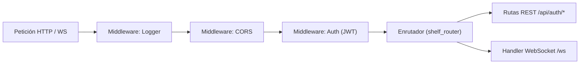

# Arquitectura del Servidor: Shelf (Brilliant Game)

Este documento detalla la arquitectura, el diseño técnico, el flujo de datos y los protocolos de comunicación del backend de **Brilliant Game**, implementado con **Shelf** en lenguaje Dart puro.

---

## 1. Visión y Responsabilidad del Servidor

El servidor de Brilliant Game actúa como una **autoridad centralizada** encargada de:
1. **Persistencia y Autenticación:** Gestionar el ciclo de vida de las cuentas de usuario y validar credenciales antes del ingreso a salas.
2. **Control de Lobbies en Tiempo Real:** Administrar las salas de juego activas, generación de códigos únicos de 5 dígitos, sincronización de estados ("Listo"), permisos de Game Master y expulsión de jugadores.
3. **Motor Central de Azar y Rondas:** Realizar la tirada autoritativa de dados globales en cada ronda y sincronizarla con todos los tableros réplica.
4. **Árbitro de Partida:** Registrar regiones completadas, adjudicar puntuaciones por orden de llegada y resolver empates en la misma ronda.
5. **Accesibilidad e Interconexión Global (Internet / WAN):** Proveer conectividad abierta hacia Internet para permitir que cualquier jugador del mundo pueda conectarse, registrarse, unirse a salas y disputar partidas en tiempo real sin restricción a redes de área local (LAN).

---

## 2. Stack Tecnológico del Backend

| Componente | Paquete / Tecnología | Propósito |
| :--- | :--- | :--- |
| **Núcleo HTTP** | `package:shelf` | Middleware, canalización de peticiones (`Pipeline`) y servidor HTTP básico. |
| **Enrutador REST** | `package:shelf_router` | Definición limpia de rutas para endpoints de autenticación y estado del servidor. |
| **Tiempo Real** | `package:shelf_web_socket` + `package:web_socket_channel` | Conexiones bidireccionales persistentes para lobbies y partidas. |
| **Persistencia** | SQLite (`package:sqlite3`) | Base de datos liviana y portable para almacenar usuarios, contraseñas y estadísticas. |
| **Seguridad / Criptografía** | `package:crypto` o `package:bcrypt` | Hasheo seguro de contraseñas con salting (nunca texto plano). |
| **Tokens de Sesión** | `package:dart_jsonwebtoken` (JWT) | Generación y verificación de tokens de acceso para autenticación sin estado en HTTP y WebSockets. |

---

## 3. Estructura del Proyecto (Monorepo)

Para maximizar la reutilización de código (especialmente las reglas de regiones, validaciones del tablero y constantes), el proyecto se organiza en tres paquetes:

```text
brilliant_game/
├── packages/
│   ├── shared/                # Lógica pura compartida
│   │   ├── lib/
│   │   │   ├── constantes.dart
│   │   │   ├── region.dart
│   │   │   ├── tablero.dart
│   │   │   └── models/        # DTOs y modelos compartidos (Usuario, Sala, Mensajes WS)
│   │   └── pubspec.yaml
│   ├── server/                # Servidor Shelf
│   │   ├── bin/
│   │   │   └── server.dart    # Punto de entrada del servidor
│   │   ├── lib/
│   │   │   ├── db/            # Conexión SQLite y repositorios
│   │   │   ├── routes/        # Rutas REST de autenticación
│   │   │   ├── services/      # Lógica de lobbies y orquestador de juego
│   │   │   └── ws/            # Handlers y controladores de WebSockets
│   │   └── pubspec.yaml
│   └── client/                # App Flutter (UI + BLoCs)
│       ├── lib/
│       │   ├── ui/            # Pantallas (Login, Menu, Lobby, Juego)
│       │   └── blocs/         # AuthBloc, LobbyBloc, GamePlayBloc
│       └── pubspec.yaml
└── Documentacion/             # Documentos y reglas de trabajo
```

---

## 4. Pipeline y Middlewares de Shelf

La canalización de Shelf procesa cada solicitud a través de capas modulares:



1. **`logRequests()`:** Registra automáticamente en consola el método, la ruta y el tiempo de respuesta.
2. **CORS Middleware:** Permite conexiones de clientes móviles y emuladores durante el desarrollo.
3. **Auth Middleware:** Valida la firma del token JWT en rutas protegidas y en el apretón de manos (*handshake*) de la conexión WebSocket.

---

## 5. Endpoints REST (Módulo de Autenticación)

### 5.1. Registro de Usuario
- **Ruta:** `POST /api/auth/register`
- **Body (JSON):**
  ```json
  {
    "username": "jugador1",
    "password": "Password123"
  }
  ```
- **Respuestas:**
  - `201 Created`: Usuario creado exitosamente. Devuelve token de sesión y datos públicos.
  - `400 Bad Request`: Datos incompletos o formato no válido.
  - `409 Conflict`: El nombre de usuario ya se encuentra registrado.

### 5.2. Inicio de Sesión (Login)
- **Ruta:** `POST /api/auth/login`
- **Body (JSON):**
  ```json
  {
    "username": "jugador1",
    "password": "Password123"
  }
  ```
- **Respuestas:**
  - `200 OK`: Credenciales correctas.
    ```json
    {
      "token": "eyJhbGciOi...",
      "usuario": {
        "id": "usr_94812",
        "username": "jugador1"
      }
    }
    ```
  - `401 Unauthorized`: Usuario o contraseña incorrectos.

### 5.3. Verificación de Sesión Activa
- **Ruta:** `GET /api/auth/me`
- **Headers:** `Authorization: Bearer <token>`
- **Respuestas:**
  - `200 OK`: Retorna la información del usuario autenticado.
  - `401 Unauthorized`: Token expirado o inválido.

---

## 6. Protocolo WebSocket en Tiempo Real (`/ws`)

Una vez autenticado el cliente, se establece una conexión WebSocket persistente hacia `ws://<host>:<puerto>/ws?token=<token>`.

### Formato de Mensajes
Todas las comunicaciones se realizan mediante JSON estructurado con `action` (o `event`) y `payload`:
```json
{
  "action": "NOMBRE_ACCION",
  "payload": { ... }
}
```

### 6.1. Acciones del Ciclo de Lobby

| Acción (Cliente -> Servidor) | Payload | Respuesta / Broadcast del Servidor |
| :--- | :--- | :--- |
| `create_room` | `{}` | `room_created`: `{ "room_code": "58129", "map_id": 1, ... }` |
| `join_room` | `{ "room_code": "58129" }` | `room_joined` al jugador y `player_joined` a la sala |
| `select_map` | `{ "map_id": 2 }` | `map_updated` (exclusivo del Game Master) |
| `toggle_ready` | `{ "ready": true }` | `player_ready_changed`: `{ "player_id": "...", "ready": true }` |
| `kick_player` | `{ "target_player_id": "..." }` | `player_kicked` al afectado y actualización al resto |
| `start_game` | `{}` | `game_started` (inicia fase de setup para todos) |

### 6.2. Acciones del Ciclo de Gameplay

| Acción (Cliente -> Servidor) | Payload | Respuesta / Broadcast del Servidor |
| :--- | :--- | :--- |
| *Automático por Servidor* | — | `dice_rolled`: `{ "dado1": 4, "dado2": 6, "ronda": 1 }` |
| `submit_placement` | `{ "ancla": 4, "x": 3, "y": 2, "valor": 6 }` | Valida jugada, actualiza tablero y emite `placement_confirmed` |
| `pass_turn` | `{}` | `player_passed` |
| `round_ended` | *Disparado por Servidor* | Calcula regiones completadas, empates y puntajes acumulados |

---

## 7. Gestión del Ciclo de Vida y Seguridad en Memoria

1. **Gestor de Salas (`RoomManager`):** Mantiene en memoria las salas activas indexadas por su código de 5 dígitos:
   - Se asegura de que ningún código se repita generando claves aleatorias únicas.
   - Si una sala queda vacía (todos se desconectan), se elimina automáticamente para liberar memoria.
2. **Desconexiones Inesperadas:**
   - Si un jugador pierde la conexión en el lobby, se marca como no listo o se remueve si pasa el tiempo de gracia.
   - Si el Game Master se desconecta en el lobby, la sala asigna automáticamente el rol de anfitrión al siguiente jugador más antiguo.

---

## 8. Despliegue y Accesibilidad Global (Acceso WAN / Internet)

Para dar cumplimiento al requisito de que **cualquier usuario pueda acceder al servidor desde cualquier parte del mundo**, el backend debe operar sobre la red pública (WAN / Internet) y no limitarse a un entorno cerrado local (`localhost` o red Wi-Fi local).

### 8.1. Estrategias de Despliegue Público
1. **Hosting en la Nube / VPS (Producción):**
   - Despliegue en proveedores PaaS / IaaS como **Render**, **Railway**, **Fly.io**, **DigitalOcean** o **AWS/GCP**.
   - El servidor Shelf se ejecuta como proceso de fondo o contenedor Docker (`dart:stable`), escuchando en el puerto asignado (por defecto `PORT` de entorno o `8080`).
   - Se le asigna un nombre de dominio o subdominio público accesible mundialmente (ej. `https://brilliant-game.onrender.com`).
2. **Túnel Seguro para Desarrollo y Evaluaciones (Testing Remoto):**
   - Utilización de herramientas de túnel cifrado (como **Cloudflare Tunnels** o **ngrok**) para exponer la instancia local de Shelf a una URL pública segura (`https://...` y `wss://...`).
   - Permite pruebas inmediatas desde dispositivos móviles externos o evaluadores remotos sin necesidad de configurar firewalls domésticos.
3. **Servidor Propio con IP Pública (On-Premise):**
   - Configuración de reenvío de puertos (Port Forwarding) en el router y DNS Dinámico (DDNS) en caso de disponer de IP pública.

### 8.2. Requisitos de Red y Seguridad para Conectividad Global
- **Cifrado en Tránsito (HTTPS y WSS):**
  - Todas las comunicaciones por Internet deben viajar cifradas vía TLS/SSL.
  - La versión Web del juego (en navegadores como Chrome o Edge) bloquea conexiones HTTP o WS planas si la app se sirve bajo HTTPS (política de *mixed content*).
- **CORS (Cross-Origin Resource Sharing):**
  - El middleware de Shelf debe configurar encabezados permisivos (`Access-Control-Allow-Origin: *`) para aceptar peticiones provenientes de clientes web alojados en cualquier dominio o emuladores remotos.
- **Tolerancia a Latencia y Pings de Mantenimiento (Heartbeats):**
  - En conexiones transcontinentales, los firewalls y routers NAT intermedios suelen cerrar conexiones WebSocket inactivas.
  - El servidor y los clientes deben implementar un intervalo de latido (`pingInterval: Duration(seconds: 30)`) para asegurar que la conexión en tiempo real permanezca abierta.
- **Configuración Dinámica en el Cliente Flutter:**
  - El cliente móvil y web no debe tener URLs cableadas (`hardcoded`).
  - Se utiliza una clase de configuración (o variables de compilación `--dart-define=SERVER_URL=...`) para alternar fácilmente entre la URL local de desarrollo y la URL pública global en producción.
