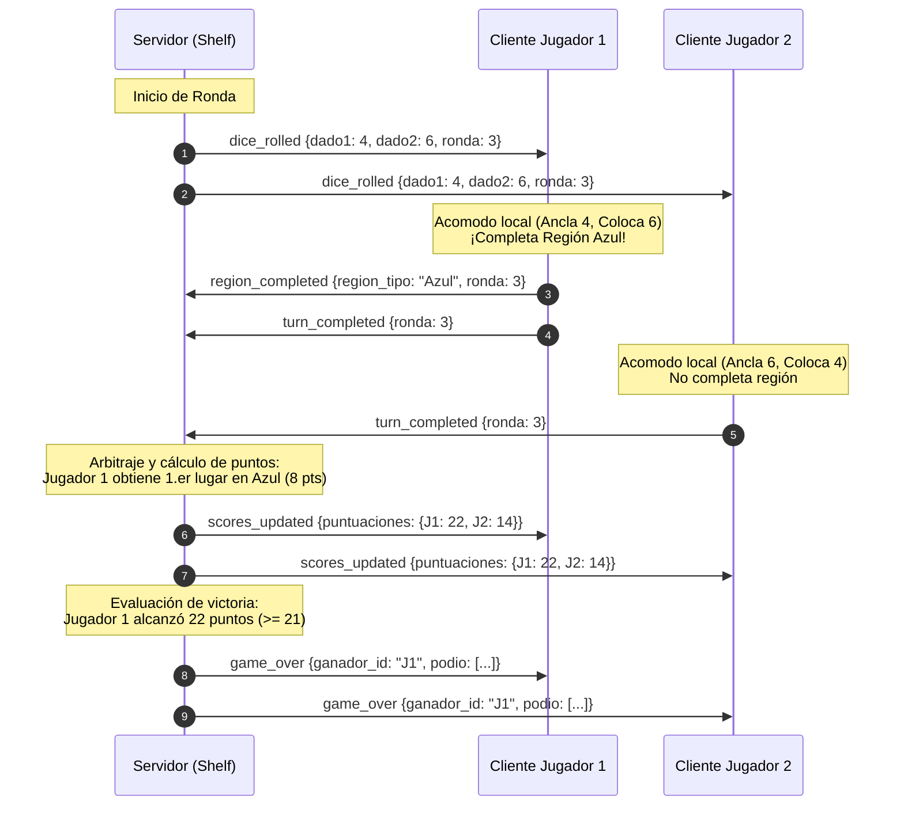

# Asignación de Responsabilidades y Funciones: Cliente vs Servidor

Este documento formaliza la distribución completa de funciones y responsabilidades del sistema **Brilliant Game**, estableciendo con precisión qué entidad (Cliente Flutter, Servidor Shelf o Ambos) es propietaria y responsable de cada operación.

---

## 1. Filosofía de Arquitectura y Separación de Responsabilidades

El diseño sigue una arquitectura desacoplada donde:
* **Servidor (Backend con Shelf):** Es la autoridad central de la partida. Controla la persistencia de usuarios, la coordinación de salas, genera de manera autoritativa el azar (dados globales), arbitra la entrega de puntos por orden de llegada (resolviendo empates de ronda) y declara oficialmente la victoria.
* **Cliente (App Flutter):** Es responsable de la experiencia de usuario visual e interactiva. Gestiona de manera autónoma el tablero del jugador: procesa la selección de dados, valida localmente el acomodo de números y la adyacencia/reglas de color, y notifica inmediatamente al servidor cuando se completa una región.

---

## 2. Matriz Resumen de Asignación de Funciones

| # | Función | Responsable Principal | Tipo de Operación |
| :---: | :--- | :---: | :--- |
| **1** | Registro de nuevos usuarios | **Servidor** | Base de datos SQLite y hasheo seguro de contraseñas. |
| **2** | Inicio de sesión (Login) | **Servidor** | Verificación de credenciales y expedición de tokens JWT. |
| **3** | Persistencia de sesión activa | **Ambos** | Cliente almacena token de forma segura; Servidor valida firma. |
| **4** | Formularios visuales de Auth | **Cliente** | Interfaz, campos reactivos, validaciones de texto y feedback. |
| **5** | Creación de sala y código de 5 dígitos | **Servidor** | Genera código numérico único y asigna rol de Game Master. |
| **6** | Validación de unión a sala | **Servidor** | Verifica existencia de código y capacidad máxima (< 6 jugadores). |
| **7** | Selección de mapa de juego | **Ambos** | Game Master elige en la UI; Servidor propaga a la sala. |
| **8** | Sincronización de lista de jugadores | **Ambos** | Servidor emite eventos; Cliente dibuja lista y avatares. |
| **9** | Alternancia de estado "Listo" (Ready) | **Ambos** | Cliente acciona botón; Servidor difunde e ilumina en verde. |
| **10** | Expulsión de jugadores (Kick) | **Ambos** | Game Master solicita en UI; Servidor desconecta y actualiza. |
| **11** | Control y validación de inicio | **Servidor** | Verifica que el 100% esté "Listo" para habilitar el arranque. |
| **12** | Carga de plantilla de mapa | **Cliente / Compartido** | Inicializa cuadrícula 7x6 y localiza las 6 casillas iniciales. |
| **13** | Colocación de números iniciales (Setup) | **Cliente** | El jugador asigna libremente los números del 1 al 6 en casillas de setup. |
| **14** | Validación de setup completado | **Cliente** | Comprueba que las 6 casillas tengan los números 1-6 sin duplicados. |
| **15** | Sincronización de inicio de rondas | **Servidor** | Espera que todos confirmen setup para lanzar la primera ronda. |
| **16** | Tirada de dados autoritativa | **Servidor** | Genera aleatoriamente los 2 dados de 6 caras por ronda. |
| **17** | Difusión de la tirada global | **Servidor** | Envía los valores idénticos de los 2 dados a todos los clientes. |
| **18** | Sincronización de cierre de ronda | **Servidor** | Espera confirmaciones de jugada/pase antes de la siguiente tirada. |
| **19** | Temporizador de ronda (opcional) | **Servidor** | Controla el reloj límite para evitar retrasos deliberados. |
| **20** | Selección de dado ancla | **Cliente** | El jugador elige qué dado usar de ancla (debe existir en su tablero). |
| **21** | Selección de casilla destino | **Cliente** | El jugador toca la celda donde desea ubicar el segundo dado. |
| **22** | Validación de adyacencia ortogonal | **Cliente** | Verifica que la casilla esté al lado de un número ancla. |
| **23** | Validación de reglas de color de región | **Cliente** | Verifica restricciones de color (único, idéntico, rangos, etc.). |
| **24** | Pasar turno (`PassTurn`) | **Cliente** | El jugador decide o se ve forzado a pasar si no tiene jugada. |
| **25** | Feedback visual de pre-completitud | **Cliente** | Ilumina la zona e indica puntos si le falta 1 celda para llenarse. |
| **26** | Detección de llenado de región | **Cliente** | Detecta localmente el momento en que una zona se llena al 100%. |
| **27** | Notificación de zona completada | **Cliente** | Emite evento WebSocket (`region_completed`) al servidor. |
| **28** | Adjudicación de posiciones por región | **Servidor** | Determina orden de llegada: 1.º, 2.º y 3.er lugar de la región. |
| **29** | Resolución de empates en la misma ronda | **Servidor** | Concede la misma puntuación máxima a empates en la misma ronda. |
| **30** | Bloqueo de regiones agotadas | **Servidor** | Cierra la región cuando se entregan los 3 puestos disponibles. |
| **31** | Cálculo y actualización de puntaje | **Servidor** | Suma puntos acumulados por jugador y mantiene tabla oficial. |
| **32** | Difusión del marcador en vivo | **Servidor** | Transmite la tabla general de puntajes a todos los jugadores. |
| **33** | Evaluación de victoria (21+ pts) | **Servidor** | Comprueba si algún participante alcanzó los 21 puntos. |
| **34** | Evaluación de fin alternativo | **Servidor** | Comprueba si todos los tableros se llenaron por completo. |
| **35** | Proclamación oficial del ganador | **Servidor** | Emite evento formal de fin de juego con el ganador y podio. |
| **36** | Pantalla de resultados / Podio | **Cliente** | Presenta la interfaz de victoria, animaciones y salida al menú. |
| **37** | Canal WebSocket persistente | **Ambos** | Mantiene el socket bidireccional abierto sobre TLS/WSS. |
| **38** | Latidos de conexión (Heartbeats) | **Ambos** | Pings/Pongs periódicos cada 30s para evitar cortes en WAN. |
| **39** | Gestión de desconexiones y cambio de host | **Servidor** | Detecta salidas inesperadas y reasigna el rol de Game Master. |

---

## 3. Detalle por Módulos y Flujos de Interacción

### 3.1. Módulo de Autenticación y Usuarios
* **Servidor:**
  - Expone rutas REST `/api/auth/register`, `/api/auth/login` y `/api/auth/me`.
  - Hashea contraseñas con salting (usando `crypto`/`bcrypt`).
  - Almacena cuentas en base de datos SQLite y emite tokens JWT firmados.
* **Cliente:**
  - Renderiza `AuthScreen` con control de visibilidad de contraseñas y validaciones reactivas.
  - Guarda el token de sesión recibido para reconexiones automáticas.

### 3.2. Módulo de Salas de Espera (Lobbies)
* **Servidor:**
  - Genera códigos numéricos aleatorios únicos de 5 dígitos (ej. `49102`).
  - Mantiene en memoria (`RoomManager`) los estados de cada sala y conexiones WebSocket asociadas.
  - Valida que nadie inicie la partida hasta que todos los jugadores tengan `esListo == true`.
* **Cliente:**
  - Renderiza `MainMenuScreen` con opciones "Crear Partida" y "Unirse a Partida" (modal de 5 dígitos).
  - En la sala de espera muestra la lista en tiempo real, iluminando en verde a quienes marquen "Listo".
  - El Game Master dispone de controles exclusivos para elegir mapa, expulsar integrantes e iniciar el juego.

### 3.3. Módulo de Setup (Preparación Inicial)
* **Cliente:**
  - Carga la plantilla del mapa seleccionado (7x6 celdas) y resalta las 6 casillas iniciales.
  - El jugador coloca libremente los números del 1 al 6 (sin repetir).
  - Valida localmente que los 6 números estén correctamente asignados y envía evento `setup_completed` al servidor.
* **Servidor:**
  - Recibe los avisos de setup completado de cada participante.
  - En cuanto el último jugador finaliza su setup, da inicio automático a la **Ronda 1**.

### 3.4. Módulo de Gameplay y Mecánica de Rondas
* **Servidor:**
  - Lanza autoritativamente los 2 dados de 6 caras en cada ronda y emite el evento `dice_rolled`.
  - Recopila los eventos de confirmación de fin de turno (`turn_completed`) o pase (`pass_turn`).
  - Inicia la siguiente ronda una vez que todos los jugadores han concluido su turno.
* **Cliente:**
  - Muestra la animación y los valores de los dos dados globales.
  - Gestiona la interacción táctil: el jugador selecciona el dado ancla y la celda destino.
  - Ejecuta las validaciones locales de adyacencia ortogonal y reglas de color de la región:
    * **Rojo / Amarillo:** Sin repetición de números.
    * **Morado / Gris:** Todos los números idénticos.
    * **Azul:** Máximo dos valores diferentes.
    * **Verde:** Libre (cualquier número 1-6).
    * **Naranja:** Variante Alta (4, 5, 6) o Variante Baja (1, 2, 3).
  - Al completar la última casilla de una región, envía de inmediato el evento `region_completed` al servidor.

### 3.5. Módulo de Arbitraje, Puntuaciones y Victoria
* **Servidor:**
  - Al recibir `region_completed`, revisa el historial de la sala para esa región específica.
  - Asigna las posiciones correspondientes (1.º puesto = puntaje mayor, 2.º y 3.er puesto).
  - Si dos o más jugadores completan la misma región dentro de la misma ronda, concede la misma puntuación máxima del puesto en disputa (resolución equitativa de empates simultáneos).
  - Transmite el evento `scores_updated` a todos los tableros con la tabla de puntuaciones en vivo.
  - Si un jugador alcanza **21 o más puntos**, emite inmediatamente el evento `game_over` con la proclamación del ganador.
* **Cliente:**
  - Actualiza el marcador flotante en la interfaz del tablero réplica.
  - Al recibir `game_over`, transiciona a la pantalla de fin de partida mostrando el podio y las estadísticas finales.

---

## 4. Diagrama de Secuencia de una Ronda Típica

